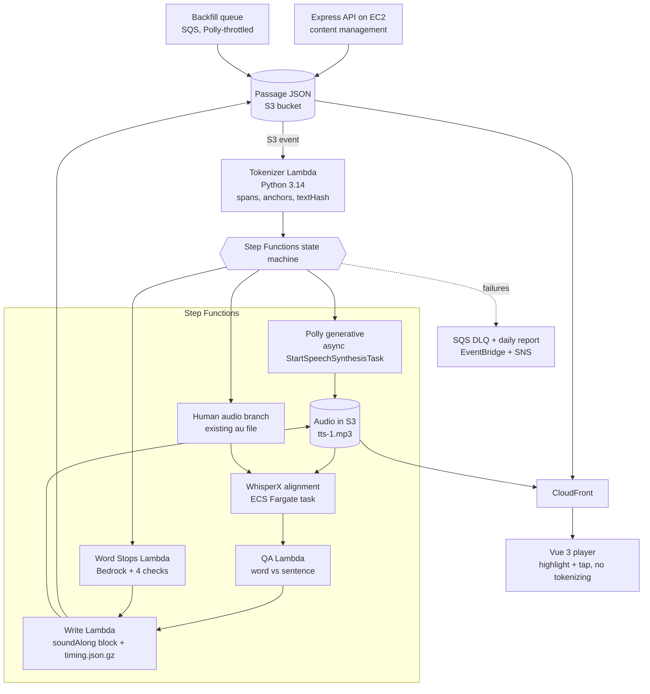

# Sound Along — AWS Implementation Spec (Kiro)

Drop this file into `.kiro/specs/sound-along/` and split it into `requirements.md`, `design.md` and `tasks.md` at the `---` markers, or keep it whole as a steering doc under `.kiro/steering/`.

Sources: ReadWorks vision document, ReadWorks technical document, Sound Along Build Guide artifact. As of 2026-11-03.

---

# requirements.md

## Context

Sound Along lets K-12 students hear a ReadWorks passage read in a human-quality voice while each word highlights in sync, and tap any word to replay from it. 6,893 passages; 36% have human audio, 64% computerized. Build is greenfield in an empty AWS sandbox over a 3-day hackathon, then hardened and launched over ~12 weeks.

## Constraints (non-negotiable)

- AWS single account, region `us-west-2`, infrastructure as code with AWS CDK 2.x
- Python 3.14 for the pipeline (Lambda), Node 18 + Express 4 for the API layer, Vue 3 for the player
- Minimal third-party libraries; prefer native JS
- No PHP, no Ruby. Go/Rust only with tech-lead approval
- Serverless for content-change-driven work (audio generation); a VM for content management; browser does playback and highlighting only
- Synthetic or publicly available passage data only; no integration with ReadWorks production until Phase 4
- Product must stay free: per-passage generation cost must be low (catalog is ~20M characters)
- Fully automated: no person in the loop per passage; ~5-person team runs it
- Accessibility for K-12 tools (keyboard, screen reader, contrast)

## User stories

### US-1 Student reads along (Must Have)
As a student, I want to press play and see each word highlighted as it is spoken, so I can follow grade-level text.
- WHEN the student presses play THEN the system SHALL play generated audio and highlight the current word within the agreed lag tolerance.
- WHEN word-level timing fails QA THEN the system SHALL fall back to sentence-level highlighting without blocking playback.
- IF the timing file's `textHash` does not match the passage's `textHash` THEN the player SHALL ignore the timing file.

### US-2 Tap to replay (Must Have)
As a student, I want to tap any word to hear it again from that point.
- WHEN the student taps a word THEN playback SHALL seek to that word's start time and resume.
- The player SHALL be operable by keyboard for play, pause and word selection.

### US-3 Human-quality narration (Must Have)
As a student, I want narration that sounds like a person.
- The system SHALL generate audio with Amazon Polly generative voices, one configured voice per language.
- The system SHALL apply one shared pronunciation lexicon per language on every run.
- Narration SHALL score higher than the current Polly TTS in a blind human-likeness rating.

### US-4 Automatic generation (Must Have)
As the content team, I want audio and timing produced from passage text with no manual step.
- WHEN a passage JSON is created or edited in S3 THEN the pipeline SHALL run without human action.
- IF the new `textHash` equals the last run's THEN the pipeline SHALL skip and incur no cost.
- WHEN a step fails THEN the system SHALL retry, then route to a dead-letter queue and a daily report, and the passage SHALL keep its current audio.

### US-5 Spanish (Nice to Have)
- The pipeline SHALL read `lang` from the passage JSON and select voice, alignment model and tokenizer rules from config.
- Spanish passages (`lang: "ES"`) SHALL use bold key words as vocab anchors linked to the paired English article.

### US-6 Timing for existing human audio (Nice to Have)
- WHEN a passage has a human `au` file THEN the pipeline SHALL skip synthesis and produce timing by forced alignment only.

### US-7 Word Stops / vocab popup (Nice to Have)
- The system SHALL draft one question per ReadWorks-tagged vocab occurrence using an LLM.
- A Word Stop SHALL publish only if: the word is a tagged vocab occurrence; every clue word exists in the passage; exactly one choice is correct; the correct choice matches the ReadWorks definition.
- Word Stops SHALL never pause playback automatically; tapping the word pauses and opens the question; Resume continues from the same word.
- Teachers SHALL have a report-a-problem control.

### US-8 Teacher assigns Sound Along (Phase 4)
- WHEN a teacher enables Sound Along on an assignment THEN the passage SHALL open with read-along available for the whole class, a group or an individual.

## Success metrics

| Metric | Target | Measured by |
| --- | --- | --- |
| Passage audio coverage | 100% of catalog auto-generated | generated ÷ total passages |
| Narration quality | beats current TTS | blind listener rating |
| Word-level timing accuracy | within agreed tolerance | sampled alignment check |
| Audio feature adoption | up vs baseline | share of assigned passages played |
| Literacy outcomes | improved for audio users | audio vs non-audio assessment scores |

## Open questions (confirm with ReadWorks at kickoff)

- [ ] Hackathon dates
- [ ] Post-hackathon allocation of the 5-person team
- [ ] `soundAlong` block inside product JSON or sidecar file?
- [ ] es-US or es-MX default Spanish voice; standalone Spanish articles or paired texts only?
- [ ] Spanish definitions available, or use paired English definition?
- [ ] Acceptable highlight lag (ms)
- [ ] Auto-publish Word Stops with automated checks, or approval step?
- [ ] Permission to use public QA passage JSON and audio as test data

---

# design.md

## Architecture

## Components

| Component | AWS service | Notes |
| --- | --- | --- |
| Passage store | S3 | One folder per article version; existing product JSON fields untouched |
| Trigger | S3 event notification → EventBridge → Step Functions | Skip when `textHash` unchanged |
| Tokenizer | Lambda, Python 3.14 | Drops figures/captions, numbered `` per word, sentence and paragraph starts, vocab occurrence → token index, `textHash` |
| Synthesis | Amazon Polly generative, async task | Voice and lexicon per language from config; async allows 100k billed chars |
| Alignment | WhisperX container on ECS Fargate (CPU; GPU on AWS Batch if needed) | `lang` picks model (en: WAV2VEC2_ASR_BASE_960H, es: VOXPOPULI_ASR_BASE_10K_ES); outputs start, end, conf per word |
| Fallback timing | Polly neural voice + speech marks | Same JSON; only `timingSource` changes; end = next word's start |
| QA | Lambda | Mean confidence + low-confidence list → `granularity: word|sentence`; never blocks |
| Word Stops | Lambda + Amazon Bedrock | Drafts question + clue spans; four automated checks gate publish |
| Write | Lambda | Writes `soundAlong` block and gzipped timing file per track |
| Failure handling | Step Functions retries → SQS DLQ → daily EventBridge/SNS report | Passage keeps current audio |
| Delivery | CloudFront over S3 | Product JSON, audio, timing files, Vue static app |
| Content API | EC2 (small), Node 18 + Express 4 | List passages, trigger re-save; the "VM for content management" |
| Backfill | SQS + consumer Lambda | Throttled to Polly quotas; one-time enqueue of 6,893 passages |
| Observability | CloudWatch dashboards and alarms | Runs, failures, cost, QA fallback rate, alignment confidence |
| IaC | AWS CDK 2.x (TypeScript), two stacks: `pipeline`, `web` | Single account, `us-west-2` |

## Data contract

- `soundAlong` block: one per article version; keys include `lang`, `textHash`, `tokenizerVersion`, `tokenCount`, `contentTokenized`, `structure{paragraphStarts,sentenceStarts}`, `vocabAnchors`, `tracks[]`, `wordStops[]`, `generation`
- `tracks[i]`: `id`, `kind` (tts|human), `engine`, `voiceId`, `lexicon`, `audioKey`, `timingKey`, `timingSource`, `granularity`, `qa{status,...}`
- Timing file: gzipped JSON, parallel arrays (`start[]`, `end[]`, optional `conf[]`), ms from audio start, index i = token i, plus `textHash`
- Player never tokenizes; renders `contentTokenized`, highlights by binary search on `start[]`, seeks on tap

## Security baseline

Least-privilege IAM per Lambda/task; private S3 with CloudFront origin access control; KMS on media bucket; Secrets Manager for any provider keys; CloudTrail and GuardDuty on; no student PII in the pipeline.

## Team

| Role | Owns |
| --- | --- |
| E1 Pipeline (Python) | Tokenizer, Polly, WhisperX, QA, timing format, lexicons, Word Stops generation |
| E2 Platform (CDK) | Stacks, S3, Step Functions, SQS/DLQ, Fargate, CloudFront, IAM, backfill, observability, cost |
| E3 Frontend (Vue/Node) | Player, Express API, demo site, accessibility, EN/ES switch, teacher toggle |
| D1 Designer (student UX) | Read-along layouts for four grade bands, highlight styles, tap/resume, accessibility review, teacher flow |
| D2 Designer (vocab + demo) | Word Stop and vocab cards, Spanish card, report-a-problem, demo script, QA sampling UI |

---

# tasks.md

## Phase 0 — Pre-hackathon spike (week 1)

- [ ] 0.1 Confirm open questions with ReadWorks; record decisions (D2, E2)
- [ ] 0.2 CDK 2.x TypeScript app, `pipeline` and `web` stacks, `us-west-2`, budget alarm, repo + CI (`cdk synth`, `pytest`) (E2)
- [ ] 0.3 Assemble 5 sample passages (3 EN, 2 ES paired) from public QA JSON; pre-clean, keep vocab ids (E1)
- [ ] 0.4 Spike both timing paths (generative + WhisperX vs neural + speech marks); measure accuracy, cost, run time; test lexicon with generative voices; pick QA threshold (E1)
- [ ] 0.5 Freeze `soundAlong` schema v3, timing file format, S3 key layout (E1, E3)
- [ ] 0.6 Vue player shell renders `contentTokenized` against example JSON (E3)
- [ ] 0.7 Design research + prototype v1: highlight styles, tap-to-replay, four grade bands (D1)
- [ ] 0.8 Prototype v1: Word Stop modal, vocab card, Spanish card, EN/ES switch, report-a-problem; demo outline (D2)
- [ ] Gate: `cdk deploy` green from CI; one passage has real audio + timing in S3; prototype signed off

## Phase 1 — Hackathon day 1: core pipeline and player

- [ ] 1.1 Tokenizer Lambda (E1)
- [ ] 1.2 S3 event → Step Functions; `textHash` skip (E2)
- [ ] 1.3 Polly async synthesis step → MP3 in S3 (E2)
- [ ] 1.4 Timing loader with gunzip + `textHash` guard; highlight via binary search on rAF (E3)
- [ ] 1.5 WhisperX alignment on Fargate; QA Lambda picks granularity (E1)
- [ ] 1.6 Fargate task def, IAM, SQS DLQ + retries, CloudWatch logs, CloudFront, static hosting (E2)
- [ ] 1.7 Tap-to-seek, playback speed, keyboard operability (E3)
- [ ] 1.8 Express content API stub on EC2 (E3, D2)
- [ ] 1.9 Device review on tablet + Chromebook; drift test on longest passage (D1)
- [ ] Checkpoints: 12:00 audio from S3-triggered run · 15:00 player highlights from real timing · 17:00 3 EN samples end to end
- [ ] Fallback: switch config to neural voice + speech marks if alignment slips

## Phase 2 — Hackathon days 2–3: stretch features, polish, demo

Day 2
- [ ] 2.1 Spanish path: es voice config, VOXPOPULI model, tokenizer rules for ¿ ¡ « », bold words as anchors (E1)
- [ ] 2.2 Human-audio branch: skip Polly, align existing `au` (E1)
- [ ] 2.3 Backfill queue + throttled consumer; 20-passage batch; daily DLQ report (E2)
- [ ] 2.4 EN/ES switch; Spanish vocab card; human track selection (E3)
- [ ] 2.5 Word Stops Lambda with Bedrock + four checks (E1)
- [ ] 2.6 Tap-only Word Stop modal with Resume (E3)
- [ ] 2.7 Cost per passage measured; demo build frozen and tagged (E2)
- [ ] 2.8 Accessibility checklist; grade-band final pass (D1)
- [ ] 2.9 Word Stop content review; report-a-problem copy (D2)

Day 3 (nothing new starts)
- [ ] 2.10 Fix day-2 defects; lexicon for sample proper names; clean regen of all 5 passages; verify `textHash` skip (E1)
- [ ] 2.11 50-passage backfill batch; throttling check; DLQ-depth alarm; cost projection slide; snapshot stacks (E2)
- [ ] 2.12 Accessibility pass with D1; drift check; device bug bash (E3)
- [ ] 2.13 Usability session with 2–3 teachers/students; top-5 findings fixed (D1, E3, E1)
- [ ] 2.14 Pipeline README + fallback runbook (E1)
- [ ] 2.15 Review all auto-published Word Stops; success-metric slide; rehearse demo twice; sign-off session (D2)
- [ ] Definition of Done: Must Haves tested · 5 passages highlight · tap-to-play on tablet + laptop · end-to-end from S3 save with no manual timing edits · deployed and demoable · stakeholder sign-off
- [ ] Cut order: Word Stops → human timing → Spanish; never the English read-along or the demo rehearsal

## Phase 3 — Hardening, security, accessibility, cost (weeks 3–6)

- [ ] 3.1 Idempotent runs on `textHash`; retries → DLQ; partial-failure handling; Step Functions timeouts; contract tests (E1) — done: 200-passage soak with zero manual fixes
- [ ] 3.2 Right-size WhisperX (Fargate CPU vs Batch GPU); warm pool; model cache in image; concurrency cap vs Polly quotas (E2)
- [ ] 3.3 Security baseline (IAM, OAC, KMS, Secrets Manager, CloudTrail, GuardDuty); security review signed (E2)
- [ ] 3.4 CloudWatch dashboard + alarms; daily DLQ report; structured logs; on-call runbook (E2, E1)
- [ ] 3.5 WCAG 2.1 AA on player; external audit; issues closed (E3, D1)
- [ ] 3.6 Drift test on 20 longest passages; mobile Safari + Chromebook; timing cache; speed 0.75x–1.5x (E3)
- [ ] 3.7 Lexicon seeded from catalog proper names; blind listener rating with 10 teachers (E1, D2)
- [ ] 3.8 Score 100 auto-published Word Stops; tune prompts/checks; report-a-problem queue + weekly review view (D2, E1)
- [ ] 3.9 Cost comparison (generative/neural/long-form); `textHash` caching; S3 lifecycle; annual run-rate; budget approved (E2)

## Phase 4 — Backfill, production integration, launch (weeks 7–12)

- [ ] 4.1 Move CDK stacks to ReadWorks account; use readworks-media bucket pattern and existing CloudFront; existing JSON fields untouched (E2, wk 7–8)
- [ ] 4.2 Backfill wave 1: 64% computerized-audio passages; weekly spot-check sample (E2, E1, wk 8–9)
- [ ] 4.3 Backfill wave 2: 36% human passages, timing only; low-confidence list to content team (E1, wk 9–10)
- [ ] 4.4 Teacher assignment flow: enable Sound Along per assignment, class/group/student (E3, D1, wk 8–10)
- [ ] 4.5 Analytics: play/tap/Word Stop events → Kinesis Firehose → S3 → Athena; teacher dashboard mockups (E2, D1, wk 10–11)
- [ ] 4.6 Load test at 1.8M weekly plays; 10-classroom pilot; fix; enable for all (team, wk 11–12)
- [ ] 4.7 Handover: runbooks, cost dashboard, DLQ report, lexicon guide (E2, wk 12)
- [ ] Ongoing: weekly QA sample, monthly cost review, quarterly voice/model refresh, audio vs non-audio outcome comparison after one term

## Risks

| Risk | L | I | Mitigation | Owner |
| --- | --- | --- | --- | --- |
| Generative voices return no speech marks; alignment inaccurate | M | H | Phase 0 spike; neural + speech-marks fallback by config | E1 |
| Lexicons don't apply to generative voices | M | M | Test in Phase 0; text substitution in tokenizer | E1 |
| Highlight drifts on long passages | M | H | `textHash` guard; end = next start; drift test day 1 | E3 |
| Three days too short for stretch + polish | H | M | Fixed cut order; day 3 starts nothing new | D2 |
| Auto-published Word Stop is wrong | M | M | Four checks; ReadWorks vocab only; report queue; weekly review | D2 |
| Full-catalog cost exceeds budget | L | M | Cost measured day 2; caching; neural option | E2 |
| Accessibility gaps | M | M | Keyboard-first from day 1; WCAG audit Phase 3 | D1 |
| Team availability drops post-hackathon | M | H | Phases 3–4 sized in weeks; confirm allocation | PM |
